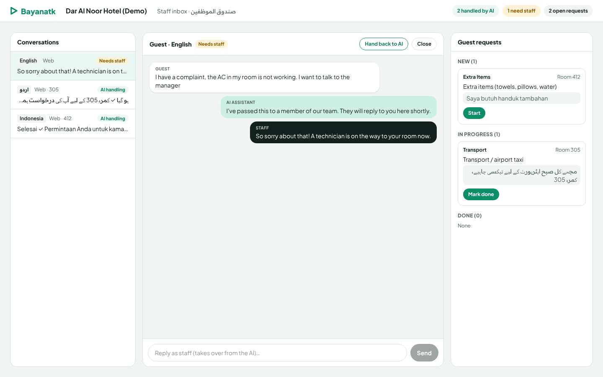

# Bayanatk Concierge

A multilingual AI guest assistant for hotels. Guests ask questions in their own language
(Arabic, English, Urdu, Indonesian, Turkish and more) by web chat or WhatsApp. The AI answers
from the hotel's own facts, turns service requests into tasks for staff, and hands anything
sensitive to a person.



| Guest chat (phone) | Guest sees a staff reply |
|---|---|
|  |  |

## What it does

- **Guest chat** (`/h/<hotel>`): a mobile chat page a guest opens from a QR code in the room.
- **AI assistant**: answers only from the hotel's facts, replies in the guest's language,
  creates service requests (housekeeping, laundry, transport, late check-out, extra items),
  and escalates complaints, payments and booking changes to staff.
- **Staff inbox** (`/dashboard/<hotel>`): live conversations with language and status,
  staff replies (which take over from the AI), and a request board: New → In progress → Done.
- **WhatsApp channel** (`/api/whatsapp`): Meta Cloud API webhook with signature checks,
  duplicate protection and fast responses.
- **Many hotels, one system**: every record belongs to a hotel; the database blocks
  cross-hotel access (tested).

## Quick start (demo mode, no keys needed)

Requires Node.js 20.9 or newer.

```bash
npm install
npm run dev
```

Open http://localhost:3000, then:
1. Click **Open the guest chat** and try the sample questions.
2. In another tab, click **Open the staff inbox** to see conversations and requests appear.

Demo mode uses a fictional hotel (Dar Al Noor), keeps data in memory, and replies with an
offline rule-based assistant. Nothing leaves your computer.

## Live mode

Copy `.env.example` to `.env.local` and fill in what you have. Each part switches on by itself:

| You set | What changes |
|---|---|
| `ANTHROPIC_API_KEY` | Real Claude answers any question, in any language, from the hotel facts |
| `SUPABASE_URL` + `SUPABASE_SERVICE_ROLE_KEY` | Data is saved in your Supabase database |
| `WHATSAPP_*` | Guests can message the hotel's WhatsApp number |
| `STAFF_ACCESS_KEY` | Staff inbox only opens with `?key=<value>` (set this before any real pilot) |

### Set up Supabase
1. Create a project at supabase.com.
2. In **SQL Editor**, run `supabase/migrations/0001_init.sql`, then `supabase/seed.sql`.
3. Copy the project URL and the **service role** key into `.env.local`.
   The service role key stays on the server; never put it in browser code.

### Set up WhatsApp
1. In Meta for Developers, create an app with the WhatsApp product.
2. Deploy this app (for example on Vercel) so it has a public HTTPS address.
3. Set the webhook URL to `https://<your-domain>/api/whatsapp`, with the same verify token
   as `WHATSAPP_VERIFY_TOKEN`, and subscribe to `messages`.
4. Fill in `WHATSAPP_APP_SECRET`, `WHATSAPP_ACCESS_TOKEN`, `WHATSAPP_PHONE_NUMBER_ID`
   and `WHATSAPP_HOTEL_SLUG`.

## Scripts

| Command | What it does |
|---|---|
| `npm run dev` | Start the app for development |
| `npm run build` / `npm start` | Production build and server |
| `npm test` | All tests: assistant logic, WhatsApp security, languages, database isolation |
| `npm run typecheck` | TypeScript checks |

## Deploying

The app deploys to Cloudflare Workers at `demo.bayanatk.com`, redeploying on every push to GitHub.
Step by step: [docs/DEPLOY.md](docs/DEPLOY.md). Try the Cloudflare build locally with `npm run cf:preview`.

## Adding a new hotel (pilot)

1. Insert a row in `hotels` with a unique `slug` (e.g. `al-noor-madinah`).
2. Add its facts to `knowledge_items`: check-in times, distance to the Haram, prices, services.
   The AI will only say what is written here.
3. Share `https://<your-domain>/h/<slug>` as a QR code in rooms, and give staff
   `https://<your-domain>/dashboard/<slug>?key=<STAFF_ACCESS_KEY>`.

More detail: [docs/ARCHITECTURE.md](docs/ARCHITECTURE.md) · [docs/ROADMAP.md](docs/ROADMAP.md) ·
working rules for AI coding tools: [CLAUDE.md](CLAUDE.md).

---
Built by Bayanatk · bayanatk.com
